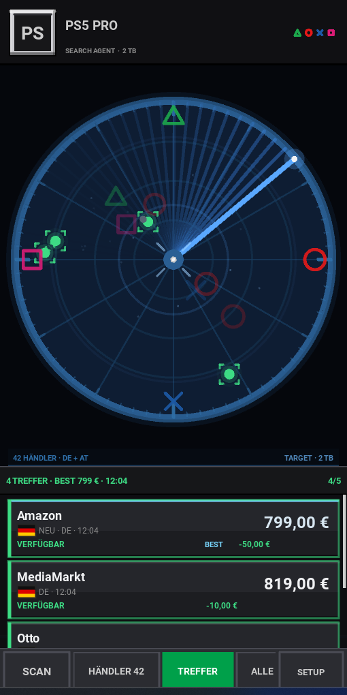
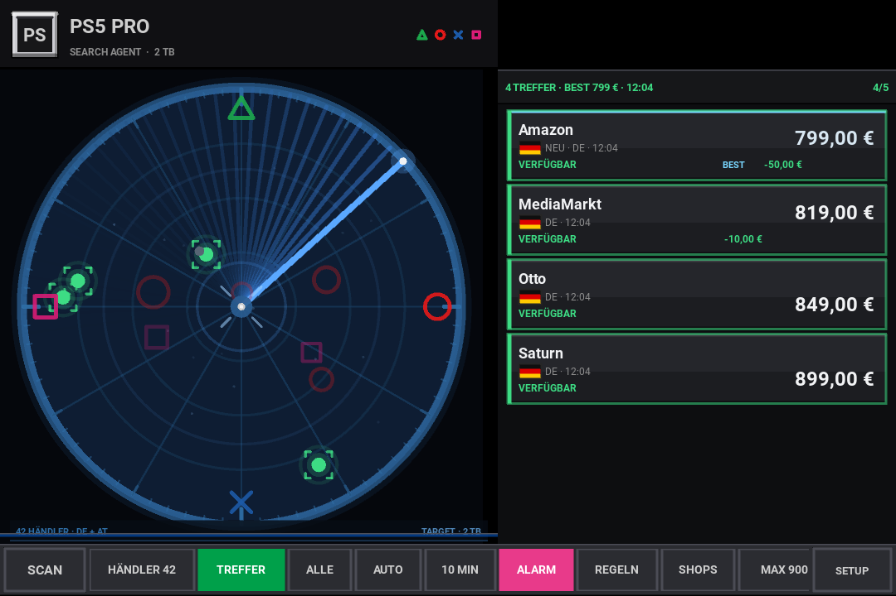
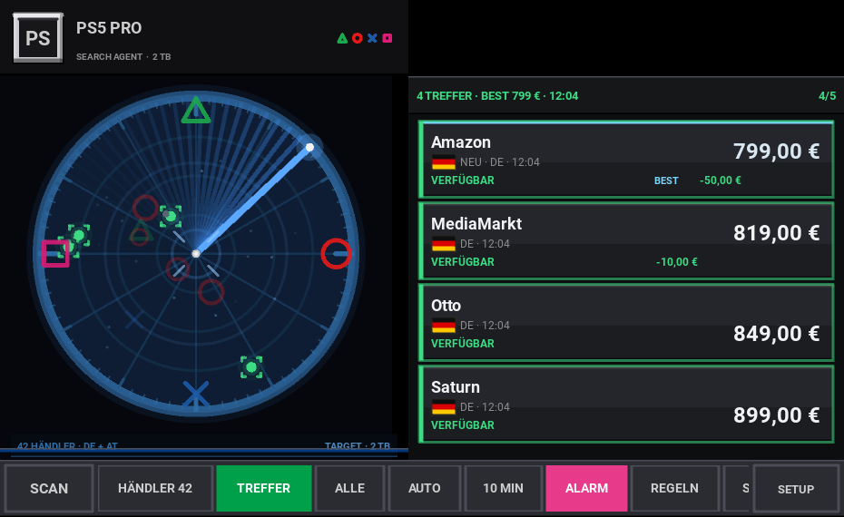
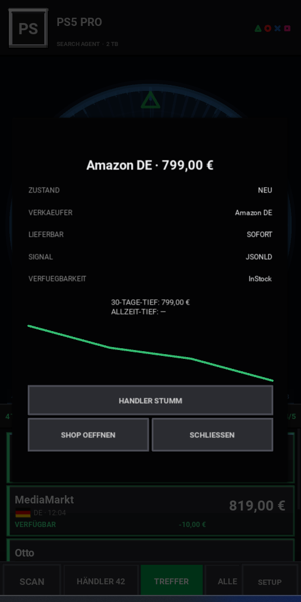
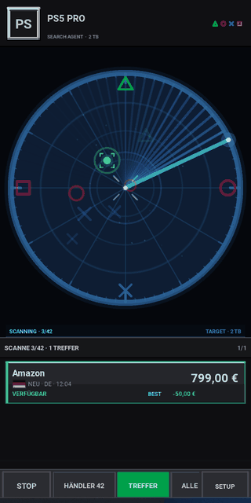

# PS5 Pro Search Agent

Android-App (Kivy/Python), die 42 Elektronikhändler in Deutschland und Österreich
gleichzeitig nach der **PlayStation 5 Pro 2 TB** abfragt: Preis, Verfügbarkeit,
Preisänderung gegenüber dem letzten Scan — als Radar im PS1-BIOS-Look.

**Von sensenmann ([@xsensenmannx](https://github.com/xsensenmannx)) — Code, Build und Dokumentation.**

  


## Direkt herunterladen

**[PS5 Pro Search Agent v1.2 als APK herunterladen](https://github.com/xsensenmannx/PS5PRoAgent/releases/download/v1.2/ps5prosearchagent-1.2-arm64-v8a.apk)**

Die APK ist für Android-Geräte mit **arm64-v8a** gebaut. Nach dem Download
die Datei antippen und die Installation aus dieser Quelle erlauben.

Die Release-APK ist mit einem festen Schlüssel signiert: Ein Update legt sich
über die bestehende Installation. Nur beim Wechsel aus der alten 5.x-Reihe ist
einmalig eine Deinstallation nötig.

| Stand | Bedeutung |
|---|---|
| **v1.2** | Die aktuelle Version (versionCode 10200). Diese APK installieren. |
| **v1.1** | Vorherige Version; bleibt als Archiv-Release erhalten. |
| **v1.0** | Der erste fertige Stand; bleibt als Archiv-Release erhalten. |

Alle Zwischenstände, Beta-Versionen und Test-Releases wurden entfernt; die
aktuelle Version steht oben. Alle Downloads:
**[github.com/xsensenmannx/PS5PRoAgent/releases](https://github.com/xsensenmannx/PS5PRoAgent/releases)**

> **Eine Nummer für alles:** App, `main`-Branch, Release und Download heißen
> **v1.2**. Der Button oben führt immer zur aktuellen APK.
>
> **Zur Zählung:** v1.2 ist die Fortsetzung der bisherigen 5.x-Stände. Die
> Zählung läuft jetzt sauber als 1.x-Linie weiter (v1.0 und v1.1 Archiv, v1.2 aktuell).

## Eindruck

| Hochformat | Querformat |
|---|---|
|  |  |
| **Kompakt quer (620×380)** – Radar links über die volle Höhe, Trefferliste rechts. So bleibt beides auch auf flachen Fenstern sichtbar. | |
|  | |

**Detailansicht** – langes Tippen auf eine Trefferkarte zeigt Zustand, Verkäufer,
Signal, Preistiefs und den Preisverlauf:



**Scan** – Radar-Sweep, Fortschritt und Treffer, die nach und nach eintreffen:



## Was die App kann

* **Parallel-Scan** über 42 Shops (DE + AT) mit 6 Threads, Retry und wechselnden
  User-Agents.
* **Preis-Erkennung** über JSON-LD (`schema.org/Product`, auch verschachtelte
  `priceSpecification` und Angebotslisten), Meta-Tags/Microdata und Text-Fallback —
  inklusive Filter gegen Zubehör (DualSense Edge, Portal, Laufwerk …) und gegen alles,
  was nicht die 2-TB-Konsole ist. Bei mehreren Angeboten gewinnt das günstigste
  neue Angebot vor Gebrauchtware; Fremdwährungen werden nicht als Euro gezählt.
* **Treffer-Logik**: „VERFÜGBAR" nur unter deiner Preisgrenze (700/800/900 €/offen),
  sonst „ZU TEUER"; Bot-Schutz und Fehler werden getrennt ausgewiesen.
* **Fairer Bot-Schutz:** 403/CAPTCHA wird erkannt und nicht wiederholt; 429
  respektiert `Retry-After` und wird höchstens einmal erneut versucht. Kein
  Captcha-Solver, keine Proxy-Rotation, kein JavaScript-Challenge-Bypass.
* **Preisverlauf**: Differenz zum letzten Scan pro Händler (`−20,00 €`, `STABIL`);
  Sparkline und 30-Tage-Tief stehen in der Detailansicht einer Trefferkarte.
* **Trefferqualität**: erkennt Zustand (neu/gebraucht), Verkäufer, Vorbestellung
  und Bot-Schutz. Gebrauchtware und Vorbestellungen lösen standardmäßig keinen
  Alarm aus; Details stehen beim langen Tippen auf einer Karte.
* **Shop-Health**: zeigt pro Händler den letzten Zustand, Fehlerzähler und
  Alter des letzten erfolgreichen Scans; auffällige Shops lassen sich einzeln
  erneut prüfen.
* **Remote-Konfiguration**: URL-Korrekturen und deklarative Parser-Regeln
  (Preis-Marker, Lieferstatus) werden über `shop_config.json` veröffentlicht
  und täglich geladen – ohne neues APK. Akzeptiert werden nur HTTPS-URLs auf
  bekannten Shop-Hosts und literale, begrenzte Marker; kein Code, keine Regexe.
* **Alarm-Regeln**: nur sofort verfügbar, nur echte Tiefstpreise, Ruhezeit
  23–07, eigene Preisgrenze und Händler-Stummschaltung. Ein Restock wird auch
  dann gemeldet, wenn der Preis gegenüber dem letzten Treffer unverändert ist.
* **Auto-Scan** im Intervall (5–60 min) und **Alarm** als Android-Benachrichtigung,
  sobald ein neuer Treffer auftaucht. Ein Tap öffnet direkt den Shop; mehrere
  Treffer eines Laufs werden gruppiert.
* **Hintergrund-Scan**: mit aktivem AUTO läuft der Scan als Foreground-Service
  weiter, wenn die App geschlossen oder das Display aus ist — inklusive Alarm.
  Im Hintergrund höchstens alle 15 Minuten, damit Akku und Datenvolumen tragen.
  Ein Heartbeat zeigt, wann zuletzt gescannt wurde; bleibt der Dienst wegen
  Akku-Optimierung stehen, warnt die App und verlinkt die Systemeinstellungen.
* **Neustart-fest**: Ist AUTO aktiv, startet der geschützte Foreground-Service
  nach einem Neustart oder App-Update automatisch wieder. Der Boot-Receiver
  prüft zuerst die lokale Einstellung und startet nur dann.
* **Kompakte Trefferliste**: Treffer erscheinen in allen Ansichten als vertikale
  Zeilen mit Händler/Status links und Preis rechts; mehrere Treffer sind gleichzeitig sichtbar.
  Im Querformat ab 600 dp wandert die Liste an den rechten Rand, das Radar bleibt
  links. Radar und Trefferliste sind in **beiden** Ausrichtungen durch einen festen
  Abstand getrennt; die Treffer-Marken bleiben innerhalb des Radarrings und
  überdecken weder Gradzahlen noch Liste. Dialoge sind in der Breite begrenzt;
  System-Insets werden berücksichtigt.
* **Abbruch**: der Scan-Button wird während eines Laufs zu **STOP**. STOP und
  App-Pause setzen ein Abbruchsignal; laufende Requests laufen höchstens noch
  bis zum Timeout, danach starten keine Retries oder weiteren Shops mehr.
* **Fortschritt**: die Kopfzeile zeigt kompakt `SCANNE 7/42 · 2 TREFFER ·
  REST ~70S`, ohne die Ergebnisliste zu verschieben.
* **Ressourcen-schonend:** das Radar zeichnet im Leerlauf 12 statt 30 Bilder/s und
  pausiert im Hintergrund, `requests` wird erst beim ersten Scan importiert. Der
  Scan nutzt ETag/Last-Modified (304 spart den Download) und bricht Antworten über
  5 MB ab; die Bot-Schutz-Prüfung liest nur die ersten 3 KB. Neue Cache-Einträge
  werden pro Scan einmal statt pro Shop geschrieben, und nach dem letzten
  Fehlversuch wartet der Retry nicht mehr unnötig.
* Filter (Treffer/alle), Sortierung (Preis/Händler/Zeit), Händler-Auswahl, kurzer
  Tap auf eine Karte öffnet den Shop im Browser.

## APK bauen

Für die normale Nutzung ist kein Build nötig: Die fertige APK steht oben.

Der einzige GitHub-Build-Weg ist der Release-Workflow
[`.github/workflows/release.yml`](.github/workflows/release.yml). Er läuft bei
einem Tag `v*`, prüft die Shop-Konfiguration und die Logiktests und hängt die
fertige APK an das GitHub-Release. Lokal auf Linux/WSL baut
`bash tools/ci_build.sh` dieselbe Release-APK; sie ist unsigniert. Der Workflow
signiert sie mit dem Release-Schlüssel (`tools/ci_sign_apk.sh`) und prüft den
Zertifikat-Fingerprint, bevor sie hochgeladen wird.

## Projektstruktur

```
main.py                       Oberfläche (Kivy) und App-Start
scan_core.py                  Scan-/Preis-/Speicherlogik ohne Kivy (auch im Service)
service.py                    Hintergrund-Scan als Android-Foreground-Service
buildozer.spec                Android-Build-Konfiguration
android_src/.../BootReceiver.java  startet den Service nach Neustart/App-Update
shop_config.json              Remote-Vorlage für URL-/Parser-Korrekturen (täglich geladen)
icon.png                      App-Icon (512×512)
assets/icon_fg.png            Adaptive-Icon Vordergrund (Android 8+)
assets/icon_bg.png            Adaptive-Icon Hintergrund
assets/notify_icon.png        Statusleisten-Icon des Hintergrund-Service
tools/selftest.py             Logiktests ohne Kivy (Release-Gate)
tools/kivy_smoke.py           Kivy-Popup-Smoke-Tests (Release-Gate)
tools/validate_shop_config.py prüft shop_config.json vor dem Release
tools/fixtures/               47 minimale Parser-Fixtures (42 Shops + Randfaelle)
tools/capture_fixture.py      Fixture aus einer echten Shop-Seite aufnehmen
tools/ci_build.sh             kompletter Build-Ablauf (CI und lokal)
tools/ci_check_apk.sh         prüft die fertige APK (Größe, Python-Version)
tools/ci_check_apk_aapt2.sh   prüft versionCode, versionName und targetSdk
tools/ci_licenses.sh          akzeptiert die Android-SDK-Lizenzen
tools/ci_fix_cache.sh         räumt halb geladene SDK/NDK-Bäume auf
tools/p4a_hook.py             ergänzt den specialUse-Subtyp im Android-Manifest
tools/release_notes.sh        Release-Beschreibung (Änderungen, Installation, SHA-256)
tools/ci_sign_apk.sh          signiert die APK mit dem festen Release-Schlüssel
tools/ci_log_failure.sh       zeigt bei einem CI-Fehler den Buildozer-Log
docs/screenshots/             Screenshots und Scan-GIF fuer dieses README
.github/workflows/ci.yml      Push/PR -> Shop-Config, Logiktests, Kivy-Smoke (4 Groessen)
.github/workflows/release.yml Tag v* -> APK als Release-Asset
LICENSE                       MIT-Lizenz
THIRD_PARTY_NOTICES.md        Lizenzen der gebündelten Bibliotheken
```

## Tests

```
python3 tools/selftest.py
python3 tools/kivy_smoke.py
python3 tools/validate_shop_config.py
```

Prüft Preis-Parsing, JSON-LD, Verfügbarkeit, Parserfehler vs. echte
Nicht-Verfügbarkeit, Bot-Schutz-Erkennung, Klassifizierung, HTTP-Cache,
Preisverlauf, Alarm-Regeln, Shop-Health, Remote-Config inklusive Parser-Regeln,
responsive Layout-Geometrie und Boot-Manifest — 699 Zusicherungen, ohne Kivy
und ohne Android. Der CI-Workflow führt sie bei jedem Push und Pull Request
aus, der Release-Workflow zusätzlich vor jedem Release. Der Kivy-Smoke-Test
ist ebenfalls ein eigenes CI-Gate und braucht kein Android-Gerät; er läuft in
der CI in fünf Fenstergrößen (360×780, 420×820, 620×380, 720×480, 884×700),
wobei 620×380 zusätzlich mit 120 % Schrift geprüft wird. Auf einem
echten Gerät prüft `tools/adb_layout_check.sh` dieselben Größen; die Bilder in
`docs/screenshots` erzeugt `tools/screenshots.py`.
`tools/validate_shop_config.py` prüft die echte `shop_config.json` mit genau
derselben Validierung wie die App und läuft im Release-Workflow vor
den Logiktests.

`tools/kivy_smoke.py` öffnet die Popups **Alarm-Regeln**, **Shop-Health**,
**System Config**, **Detailansicht** und **Onboarding** mit echtem Kivy, prüft
Inhalt, Größe und ob die Beschriftungen vollständig in ihre Widgets passen, und
klickt die wichtigsten Schaltflächen durch. Er nutzt ein temporäres Datenverzeichnis und
ersetzt alle Netzwerk-, Benachrichtigungs- und Browser-Aufrufe. Auf Linux ohne
Display läuft er über Xvfb:

```bash
xvfb-run -a python3 tools/kivy_smoke.py
```

## Fixtures vor dem Release

Für jeden der 42 Shops liegt eine kleine Fixture in `tools/fixtures/`; die
Suite prüft damit Preis, Produkt, Zustand, Verfügbarkeit und Lieferstatus,
ohne eine Shop-Seite zu laden. Zusätzlich decken die Fixtures JSON-LD, Meta-Tags,
Text-Fallback, Vorbestellung, Gebrauchtware und Ausverkauf ab. Fehlt ein Shop
oder ändert sich ein Parser unerwartet, schlägt `tools/selftest.py` vor dem
Build fehl.

Die eingecheckten Fixtures sind bewusst kleine, lizenzfreie Vertragsausschnitte.
Eine echte Seite lässt sich jederzeit manuell aufnehmen:

```bash
python3 tools/capture_fixture.py --shop "Amazon DE"
python3 tools/capture_fixture.py --shop "Amazon DE" --input page.html
python3 tools/capture_fixture.py --all --force
python3 tools/capture_fixture.py --check
```

Der Helfer nutzt denselben `scan_core`-Pfad, speichert keine dauerhafte
HTTP-Cache-Datei des Nutzers und reduziert die Seite auf Titel, relevante
Meta-Tags, JSON-LD sowie Text-/Attribut-Ausschnitte. Er lehnt fremde Hosts und
Bot-Challenges ab. `--input` arbeitet offline; `--full` ist der Notausgang, wenn
eine echte Seite durch die Minimierung anders geparst würde. Die CI führt den
Helfer nicht aus und braucht keinen Shop-Zugriff.

## Versionshistorie

Aktueller Stand und Archiv:

* **v1.2** – Die aktuelle Version (versionCode 10200): flaches Querformat bleibt
  zweispaltig, Radar und Trefferliste sind auch bei 620×380 sichtbar (inklusive
  Status- und Navigationsleisten). Dazu Geräteprüfung über ADB, ein
  reproduzierbares Screenshot-Werkzeug und `RELEASING.md`.
* **v1.1** – Vorherige Version (versionCode 10100): Radar und Trefferliste sind
  in Hoch- und Querformat fest getrennt, die Treffer-Marken bleiben innerhalb
  des Radarrings, die Gradzahlen werden nicht mehr angeschnitten. Dazu kommen
  die frei skalierbare Schrift (SETUP), Parserfehler getrennt von echter
  Nicht-Verfügbarkeit, Radar-HUD mit Scan-Fortschritt und Zielmarken,
  Bestpreis-Markierung, der Metall-Verlauf der Trefferliste und die zentrale
  `SETUP`-Systemkonfiguration. Enthält alle älteren Parser-, Alarm- und
  Hintergrunddienste.
* **v1.0** – Der erste fertige Stand (targetSdk 36). Bleibt als Archiv-Release
  erhalten.

## Signatur und Updates

Die Release-APK wird im Workflow mit einem **festen Schlüssel** signiert
(PKCS#12, Alias `ps5pro`). Dadurch installiert Android eine neue Version über
die bestehende Installation, ohne dass die App deinstalliert werden muss.

`versionName` und `versionCode` kommen aus dem Tag: `v1.2` wird zu `1.2` und
`10200` (`MAJOR*10000 + MINOR*100 + PATCH`), siehe
`tools/set_version_from_tag.sh`.

Zertifikat (öffentlich; im Workflow als Sollwert hinterlegt):

```
SHA-256  63:E5:1D:83:8B:FE:14:38:C6:D6:14:3D:F9:7D:46:D5:73:55:BC:D3:83:3A:BB:44:A2:31:BE:CF:D5:C5:70:DD
```

Der private Schlüssel liegt **nicht** im Repository. Für den Release-Workflow
sind zwei Repository-Secrets nötig (Settings → Secrets and variables → Actions):

| Secret | Inhalt |
|---|---|
| `ANDROID_KEYSTORE_BASE64` | Base64 der PKCS#12-Datei `release.p12` |
| `ANDROID_KEYSTORE_PASSWORD` | Passwort des Keystores |

Keystore und Passwort zusätzlich offline sichern: Gehen sie verloren, lassen
sich keine Updates mehr über bestehende Installationen legen.

## Displays und Datenschutz

Die Aufteilung hängt an der Fensterfläche in dp, nicht an der Pixelzahl:

| Fläche | Aufteilung |
|---|---|
| ab 600 dp Breite und 300 dp Höhe | Radar links, Trefferliste rechts – auch flach (z. B. 620×380) |
| schmaler oder flacher | Radar oben, Trefferliste unten |

Abgesichert ist das in `tools/selftest.py` (inklusive Status- und
Navigationsleisten) und im Kivy-Smoke-Test bei 360×780, 420×820, 620×380,
720×480 und 884×700 dp. Auf einem echten Gerät prüft
`tools/adb_layout_check.sh` dieselben Größen über ADB, liest die berechnete
Radarfläche aus dem Log und legt Screenshots ab.

**Netzwerk:** Die App ruft nur die Shop-Adressen aus `shop_config.json` und die
Konfigurationsdatei im Repository ab. Keine Konten, keine Werbe- oder
Analyse-SDKs, keine Telemetrie; Treffer, Verlauf und Einstellungen bleiben
lokal auf dem Gerät.

## Grenzen

* Hintergrund-Scans können von OEM-Akku-Managern beendet werden; der Boot-Receiver
  startet nach Neustart/Update nur, wenn AUTO aktiv ist. Der Heartbeat zeigt,
  ob der Dienst tatsächlich läuft, und verlinkt die Systemeinstellungen.
* Der Boot-Start erfolgt erst nach dem Entsperren (kein Direct-Boot-Zugriff auf
  die Einstellungen). Nach einem vom Nutzer erzwungenen Stopp startet Android
  den Receiver erst wieder nach dem nächsten manuellen Öffnen der App.
* Shops ändern URLs und verschärfen Bot-Schutz. Einzelne Händler können dauerhaft
  „BOT-SCHUTZ" melden — dann hilft eine neue URL oder eine Parser-Regel in der
  Remote-Datei `shop_config.json`.

## Shop-URLs und Parser-Regeln ohne APK aktualisieren

`shop_config.json` wird aus dem `main`-Branch geladen und vor dem Anwenden
vollständig validiert. Ein einziger Fehler verwirft die ganze Datei; dann bleibt
die zuletzt gültige bzw. die eingebaute Konfiguration aktiv.

```json
{
  "schema": 1,
  "updated": "2026-11-12",
  "shops": {
    "MediaMarkt DE": {
      "urls": ["https://www.mediamarkt.de/de/product/_sony-playstationr5-pro-2-tb-konsole-3018022.html"],
      "parser": {
        "price_before": "data-ps5-price=\"",
        "price_after": "\"",
        "in_stock": ["Auf Lager"],
        "out_of_stock": ["Ausverkauft"],
        "preorder": ["Vorbestellung"],
        "immediate": ["Sofort lieferbar"]
      }
    }
  }
}
```

**URLs:** nur absolute HTTPS-URLs auf Hosts der eingebauten Händlerliste,
höchstens 3 pro Shop, ohne Zugangsdaten, ohne Port außer 443 und ohne Fragment.
Doppelte URLs und unbekannte Shops werden abgelehnt.

**Parser-Regeln:** `price_before` und `price_after` bilden ein Paar aus exakten,
literalen Markern; dazwischen läuft der vorhandene Preisparser. `in_stock`,
`out_of_stock`, `preorder` und `immediate` sind Listen literaler Textmarker
(maximal 8 pro Feld, 120 Zeichen pro Marker); sie werden ohne Beachtung der
Groß-/Kleinschreibung gesucht, `out_of_stock` gewinnt konservativ. Es gibt
bewusst **keine freien Regexe und keinen ausführbaren Code** aus der Remote-Datei
— damit sind ReDoS und Code-Injektion ausgeschlossen. Preis- und Lieferregeln
haben Vorrang vor JSON-LD/Meta/Text, fallen bei fehlendem Treffer aber sauber
zurück. Bei einer Regeländerung wird der alte HTTP-Cache des betroffenen Shops
verworfen, damit ein 304 nicht den alten Preis konserviert.

App und Hintergrund-Service laden höchstens einmal pro Tag und nutzen ETag/304.
Der Button **SHOPS → REMOTE-CONFIG AKTUALISIEREN** erzwingt einen Abruf.
* Die veröffentlichte APK ist eine Release-APK zum Sideloading; ein Play-Store-Upload ist nicht eingerichtet.

## Autor

**sensenmann** — Code, Build-Skripte, App-Icon und Dokumentation dieses Projekts.

* GitHub: [@xsensenmannx](https://github.com/xsensenmannx)
* Fehler und Wünsche: [Issues](https://github.com/xsensenmannx/PS5PRoAgent/issues)
* Alle Stände: [Releases](https://github.com/xsensenmannx/PS5PRoAgent/releases)

## Lizenz

MIT — siehe [LICENSE](LICENSE). Du darfst die App frei nutzen, verändern und
weitergeben, solange der Copyright- und Lizenzhinweis erhalten bleibt.

Die APK bündelt zusätzlich Kivy, python-for-android und weitere
Open-Source-Bibliotheken. Deren Lizenzen (MIT, BSD-3-Clause, Apache-2.0,
MPL-2.0, PSF-2.0 u. a.) stehen mit Copyright-Hinweisen in
**[THIRD_PARTY_NOTICES.md](THIRD_PARTY_NOTICES.md)**; die MIT-Lizenz hier
betrifft nur den Projektcode.
